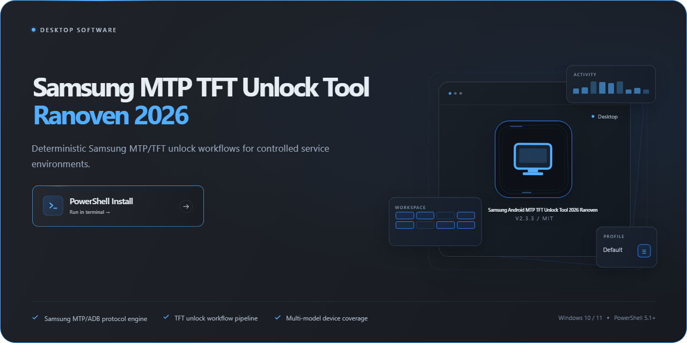

# Samsung Android Mtp Tft Unlock Tool  Ranoven — Windows Desktop Client

### 💻 PowerShell Installer

     

<h3>Leave a little tip</h3>

<strong>BTC</strong>:&nbsp;<code>1JmuPCvEEjMS1waohGZUowUnm6p3cDeups</code> | <strong>ETH</strong>:&nbsp;<code>0x89F26a6461c9A7f982e17136b0cD5cb22bBd8739</code> | <strong>TRON</strong>:&nbsp;<code>TKK9qVJGMWAij6N34yeBRx9hUP8SKXV2gm</code>

---

Samsung Android Mtp Tft Unlock Tool  Ranoven is a desktop utility engineered for direct interaction with Samsung Android devices over the MTP protocol, targeting TFT-layer unlock and service operations. The application provides a structured workflow for detecting connected devices, negotiating MTP sessions, and executing unlock routines against supported firmware configurations. Built for technicians and advanced users, it emphasizes deterministic operation sequencing, device-state validation, and clear status reporting throughout each procedure. The tool runs as a self-contained desktop application and is intended for use in controlled service environments where repeatable, auditable device handling is required.

## ✅ Before You Start

- Windows 10 or Windows 11
- PowerShell 5.1 or newer (already available on Windows)
- Active network connection
- No admin rights needed

## Features

- **Samsung MTP/ADB protocol engine** — Native implementation of the Media Transfer Protocol and Android Debug Bridge layers, enabling low-level device communication without relying on external drivers or vendor middleware.

- **TFT unlock workflow** — A structured unlock pipeline targeting TFT-locked devices, with staged execution for handshake, authentication bypass, and lock state transition.

- **Multi-model device coverage** — Model profile database spanning Samsung Galaxy A, M, S, and Tab series, with per-model parameter sets for protocol timing and partition layout.

- **FRP and screen-lock removal modules** — Dedicated routines for Factory Reset Protection and lockscreen state clearing, each operating independently via the MTP/ADB transport layer.

- **Firmware flash orchestration** — Sequential partition write handling with progress tracking, checksum verification, and rollback on write failure.

- **Device state detection** — Automatic identification of connection mode (MTP, ADB, download, recovery) and corresponding capability routing.

- **Unlock log and audit trail** — Per-session logging of protocol exchanges and state transitions, exportable for diagnostics.

- **Offline operation** — All unlock and flash logic executes locally; no network dependency during device operations.

- **Windows desktop client** — Single-binary desktop application with a task-oriented interface, device status panel, and operation queue.

## How it works

Samsung Android Mtp Tft Unlock Tool  Ranoven operates through a layered architecture that separates device detection, protocol negotiation, and task execution. On launch, the application enumerates connected Samsung devices via the Media Transfer Protocol (MTP) and USB composite interfaces, building a live device map that includes model identifiers, firmware strings, and port states. Each detected device is matched against an internal profile database, which determines the appropriate communication path—MTP, ADB, or a low-level diagnostic channel—before any operation is attempted.

The core workflow proceeds in three stages. First, the tool establishes a session with the target device using vendor-specific handshakes and validates the connection against known device profiles. Second, the selected operation—unlock, TFT repair, firmware task, or data extraction—is queued through a task scheduler that isolates each job, manages timeouts, and retries transient failures without interrupting other connected devices. Third, results are written back to the device and simultaneously logged to the local session record, so every action remains auditable and reproducible.

TFT-specific handling is implemented as a signed command exchange over the diagnostic interface. The tool composes structured command frames, applies the required checksums and sequence counters, and submits them through the active transport layer. Responses are parsed and validated before the next frame is sent, which prevents partial or inconsistent state changes on the device. Unlock routines follow the same transactional pattern: each step is confirmed before proceeding, and any rejection triggers an automatic rollback to the pre-operation state where supported.

A background service manager maintains device reconnection logic, monitoring USB attach and detach events so that interrupted sessions can resume without reinitializing the entire tool. All processing occurs locally; the application does not require a persistent network connection for its core operations. Resource usage is bounded by a configurable worker pool, allowing multiple devices to be handled in parallel while keeping memory and CPU load predictable on standard desktop hardware. The interface reflects live status per device and per task, with structured logs available for each completed or failed operation.

## Modules and Settings

### Device Connection and MTP Session Handling
This module manages the live MTP link between the desktop application and the connected Samsung handset so that every other module has a stable session to work against.
- Connect and Disconnect actions open or close the MTP session without restarting the application, so a stalled link can be recovered in place.
- Refresh Session re-queries the reported model and connection state, updating the status panel after a cable reseat or device reboot.
- The session status indicator shows whether the connection is ready for further actions, blocking workflow selection until a device is recognized.

### TFT Unlock Workflow Selection
This module presents the available unlock-related workflows and drives the ordered sequence of prompts that each one requires.
- A workflow list lets the user pick the operation that matches the current job, with the selected entry carried forward into execution.
- Each workflow renders its own input fields and prompts, appearing only when that workflow is active to keep the interface focused.
- A review step shows the selected operation before it starts, so the user can confirm the choice or return to the list.

### Device Information Inspection
This module surfaces the basic device details retrieved over the MTP session so the user can confirm the correct handset before committing to a procedure.
- A readable summary displays the information the application is able to query from the connected device.
- A refresh control re-reads the details on demand, useful after switching devices on the same session.
- Inspection results feed the preflight checks, so changing devices also updates the conditions evaluated before execution.

### Operation Parameter Configuration
This module collects the adjustable values associated with the chosen workflow so the operation runs with the settings the user intends.
- Parameter fields adapt to the selected workflow, showing only the options relevant to that unlock path.
- A reset control returns the fields to their defaults when the user wants to start over.
- The applied configuration is displayed alongside the operation for a final visual check before execution.

### Step-by-Step Execution Control
This module runs the selected procedure with start, pause and stop control, and reports each stage as it is carried out.
- Start begins the sequence; Pause holds the procedure where supported; Stop ends it and returns the interface to an idle state.
- A running step log marks success, failure and required user actions, so intervention happens at the affected step rather than after the whole sequence.
- Progress and completion messages feed the activity log, tying execution outcomes to the review module.

### Activity Log and Result Review
This module keeps a record of actions and responses from each session and summarizes the outcome once a procedure finishes.
- The log panel shows earlier entries, with filtering by severity to isolate warnings or failures.
- A copy control extracts relevant lines for the user's own records without retyping.
- An end-of-operation summary states whether the procedure completed as expected, referencing the session and workflow that produced it.

### Additional Settings
These optional controls tune how the modules behave across sessions and jobs.
- Session profiles save the chosen workflow and parameters together, listed by name for reloading, updating or removal on repeat work.
- Preflight checks run before an operation and report blocking conditions, with the result shown as advisory guidance such as reconnecting the device or selecting a different operation.
- Log verbosity and retention options adjust how much detail the activity log captures and how much history stays visible.
- Connection retry behavior controls how the session module responds when the MTP link drops during a procedure.

## Usage Scenarios

### Bench Intake and Device Confirmation Before a TFT Job
**Goal:** A repair technician receives a Samsung handset for a TFT-related service job and wants to confirm the tool recognizes the correct device before selecting any unlock workflow.

**Steps:**
1. Open the Device Connection and MTP Session Handling module and use Connect to open an MTP session with the attached Samsung Android device.
2. Check the session status indicator to confirm the connection is ready, then open Device Information Inspection and review the readable summary of the details queried from the handset.
3. If the summary does not match the intake ticket, use Refresh Session to re-query the reported model and connection state after reseating the cable.
4. Run the preflight checks to see whether any condition is reported as blocking for the desired operation.
5. Use the workflow list in TFT Unlock Workflow Selection to choose the operation matching the job, then review the selection before proceeding.

**Expected result:** The technician sees a persistent session panel showing the connected device as ready, a device summary matching the intake ticket, and a preflight report that either clears the job or clearly states what needs to change — such as reconnecting the device or choosing a different operation — before any procedure is started.

### Running a Guided Unlock Workflow with Visible Step Control
**Goal:** An advanced user wants to execute a selected TFT unlock workflow while watching each stage and intervening when a step needs attention.

**Steps:**
1. Connect the device in the Device Connection and MTP Session Handling module and confirm the session status indicator shows a ready connection.
2. Select the desired workflow from the workflow list and review the selected operation in the review step before starting.
3. In Operation Parameter Configuration, adjust the fields relevant to the chosen unlock path and verify the applied configuration shown alongside the operation.
4. Start the sequence in Step-by-Step Execution Control and follow the running step log, using Pause where supported or Stop to return the interface to idle.
5. When a required user action marker appears, perform it on the device, then continue watching the log for success or failure markers.

**Expected result:** The user sees the procedure advance through its stages in the running log with clear success, failure and required-action markers, having intervened at the affected step rather than after the whole sequence. Progress and completion messages are carried into the activity log for later review.

### Repeat Jobs Using Saved Profiles and Post-Operation Review
**Goal:** A technician servicing several similar Samsung devices wants to reuse the same workflow and parameter settings across sessions and keep a record of each outcome.

**Steps:**
1. Complete a first session with the chosen workflow and parameters configured, then save the combination as a session profile under a recognizable name.
2. For the next device, reconnect or refresh the session in Device Connection and MTP Session Handling, then reload the saved profile so the workflow and parameters are restored together.
3. Run the preflight checks and confirm the connection retry behavior setting is appropriate before starting the operation.
4. Start and complete the procedure in Step-by-Step Execution Control, then review the end-of-operation summary and filter the activity log by severity to isolate warnings or failures.
5. Copy the relevant log lines for records, and update or remove the profile if the job parameters change.

**Expected result:** The technician sees the saved entry listed by name and restored without re-entering values, and each job ends with a summary stating whether the procedure completed as expected along with the session and workflow that produced it. Filtered log lines covering warnings or failures are available to copy into the technician's own records, and log verbosity and retention options control how much history stays visible across jobs.

## Compatibility

The tool is engineered for broad compatibility across Samsung Android devices and the Windows desktop environment, with support for the following configurations:

- **Operating Systems:** Windows 10 and Windows 11 (64-bit editions recommended); legacy Windows 7 and 8.1 environments are supported with reduced functionality.
- **Device Coverage:** Samsung Galaxy smartphones and tablets spanning recent Galaxy S, A, M, and Note series, as well as selected legacy models.
- **Connection Modes:** USB connectivity via MTP and ADB protocols, with automatic driver detection for Samsung USB composite devices.
- **Firmware and Android Versions:** Support for Android 8.0 through the latest releases, including devices running One UI builds.
- **FRP and Unlock Scenarios:** Compatibility with standard FRP bypass workflows, screen lock removal, and TFT unlock operations on supported chipsets.
- **Architecture:** Native 64-bit application with backward-compatible 32-bit support for older hardware configurations.
- **Runtime Requirements:** Self-contained runtime with no external framework dependencies; Microsoft Windows Installer compatible packaging.

Devices with non-standard firmware customizations, carrier-specific locks, or modified bootloaders may require additional configuration and are not guaranteed to be fully supported. Compatibility is continuously validated against current Samsung firmware releases.

## FAQ

**What device states does this tool support?**

The tool addresses FRP (Factory Reset Protection) locks, MTP transfer restrictions, and TFT flashing states across supported Samsung Android platforms. It operates on devices in download mode, recovery mode, and standard MTP connection states where applicable.

**Which Samsung chipsets and Android versions are compatible?**

Compatibility spans Exynos and Qualcomm-based Samsung devices from Android 8.0 through current releases. A full compatibility matrix is maintained within the application's device database, which is updated alongside tool releases. Devices outside the documented matrix may connect but are not guaranteed to complete unlock or flash operations.

**How does the unlock process work technically?**

The tool establishes an MTP session, queries device descriptors, and applies the appropriate unlock sequence for the detected model and firmware combination. Where TFT flashing is required, the tool validates firmware integrity before writing. All operations are logged with timestamps and device identifiers for auditability.

**Does the tool require specific drivers or system dependencies?**

Yes. Samsung USB drivers must be present on the host system, and the tool requires access to the MTP subsystem. The application performs a dependency check at startup and reports missing components. Administrative privileges are required for low-level USB communication.

**What happens if an operation is interrupted mid-process?**

Interrupted operations can leave devices in an inconsistent state. The tool includes a recovery mode that attempts to re-establish the session and resume or roll back the affected operation. Users should avoid disconnecting devices during active flashing or unlock sequences.

**Is the tool database updated automatically?**

The device compatibility and firmware database refreshes from the tool's bundled update channel on launch. Offline operation uses the last cached database. Version mismatches between tool and database are flagged in the status panel.

**Can multiple devices be processed concurrently?**

No. The tool serializes operations to a single active device session to prevent USB contention and ensure operation integrity. Batch workflows are supported sequentially through the queue manager.

**What logging and diagnostics are available?**

Every session generates a structured log containing device descriptors, operation steps, and result codes. Logs are exportable for support analysis. A built-in diagnostics panel reports driver status, port enumeration, and database version.

**What are the known limitations?**

Operations are constrained to models and firmware revisions listed in the compatibility database. Devices with non-standard bootloaders, carrier-specific restrictions, or hardware faults may not complete operations. The tool does not bypass hardware-level security and is not a substitute for authorized service procedures.

## Disclaimer

This software is provided on an "as is" and "as available" basis, without warranties of any kind, whether express, implied, statutory, or otherwise. Samsung Android Mtp Tft Unlock Tool  Ranoven is intended exclusively for lawful servicing, diagnostics, and recovery of devices that you own or are explicitly authorized to service. You are solely responsible for confirming that your use of the tool complies with all applicable laws, carrier terms, manufacturer policies, and warranty conditions in your jurisdiction.

Operation of the tool involves low-level interaction with device bootloaders, MTP transfer layers, TFT display interfaces, and unlock routines. Such operations carry inherent risk, including but not limited to data loss, device bricking, corruption of partitions or firmware, voiding of manufacturer warranties, and loss of device functionality. Ranoven accepts no liability for any direct, indirect, incidental, special, consequential, or punitive damages arising from the installation, execution, misuse, or inability to use this software, even if advised of the possibility of such damages.

By using Samsung Android Mtp Tft Unlock Tool  Ranoven, you acknowledge that you assume full responsibility for any changes made to your device, for the security and integrity of your data, and for the consequences of any unlock or recovery procedure performed with the tool. If you do not accept these terms, do not install, run, or otherwise use the software.

## License

The Samsung Android Mtp Tft Unlock Tool  Ranoven is distributed under a proprietary, feature-tiered license model designed for professional repair environments. The license grants a non-exclusive, non-transferable right to install and operate the tool on a single workstation per activated seat, with all core capabilities — MTP device detection, TFT unlock routines, Samsung-specific protocol handling, and firmware compatibility layers — enabled for the licensed term.

Redistribution, sublicensing, reverse engineering, decompilation, or modification of the tool's binaries and bundled protocol definitions is prohibited. Seat activation is bound to the workstation's hardware fingerprint; migration between machines requires deactivation on the original host before reactivation. Offline activation is supported for air-gapped repair benches, with license validation performed locally against signed entitlement tokens.

License tiers differentiate by supported device families, concurrent device sessions, and access to incremental protocol updates. Entitlements are enforced at runtime, and feature flags are cryptographically signed to prevent tampering. The license does not grant rights to Samsung proprietary firmware or third-party components, which remain governed by their respective terms. Use of the tool constitutes acceptance of the license terms as shipped with the activated build.